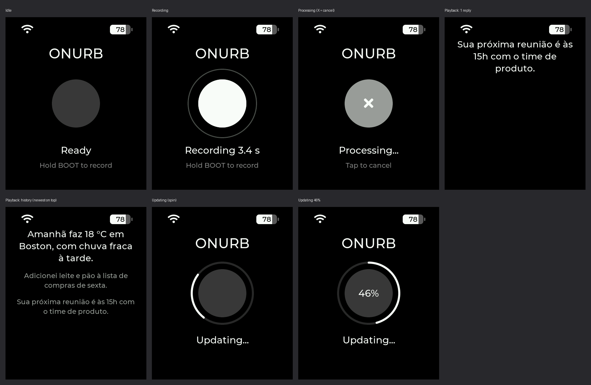

# Onurb

**Onurb** is a personal voice assistant on the wrist: firmware for the
[Waveshare ESP32-S3-Touch-AMOLED-2.06](https://github.com/waveshareteam/ESP32-S3-Touch-AMOLED-2.06) smartwatch,
a gateway, and a Claude Code agent that acts on the user's WhatsApp, calendar, notes, browser,
terminal agents and this repo itself.

Raise the watch to your mouth (a trained wrist gesture) or press the button, speak, and the
answer comes back on the screen. Anything that leaves on your behalf (a WhatsApp message, a
purchase) is shown on the watch first and goes out only after you tap **Confirm**.

> **Status:** in daily use on the real watch. Hardware, firmware and the agent run every day;
> the shopping flow is built but not yet tested end to end.



## What it does

| Area | What happens |
|---|---|
| Talking to it | Gesture (raise to mouth, on-device model) or button. Each request becomes a **thread** on the watch; you answer a thread by voice, or add to a running one. A red X cancels; a tap on it marks a false gesture trigger (training data) |
| WhatsApp | Reads your chats (wacli, read-only). Messages you dictate become a WhatsApp-style preview (photo, bubbles, Edit / Cancel / Confirm); sent only on Confirm. **Scheduled sends**: "manda pro X amanhã às 9h": confirm once, the server sends it on time |
| Background tasks | Long work (research, browsing, watching your terminal agents) runs in the background and the result comes back to the watch |
| Docs | Lists, reports and research go to **Notion**, under the user's ONURB page, with the link on the watch |
| herdr | Reads, prompts and answers the user's Claude Code agents in [herdr](gateway/skills/herdr/SKILL.md); approves only read-only lookups |
| Instinct | Email, groceries, to-dos and reminders go to the user's other assistant, Instinct |
| Shopping | Researches the main stores, picks one option, stages it at checkout and shows photo, total and reasoning on the watch; buys only on Confirm, under a per-purchase ceiling ([skill](gateway/skills/shopping/SKILL.md)) |
| Code tasks | "Change how the watch does X": a code agent edits this repo, builds, commits locally, and the watch updates itself over Wi-Fi |
| Mac → server bridge | Claude Code sessions on the Mac can send files to the server, start sessions there and read them ([remote/](remote/README.md)) |

## How it fits together

```
watch ──HTTPS──▶ Cloudflare tunnel ──▶ server gateway (always on)
  │                                      ├─ while the Mac answers: proxies to the Mac's gateway (Tailscale)
  │                                      ├─ otherwise: its own agent (no herdr, no Mac-only data)
  └─ at home: plain HTTP to the Mac      ├─ wacli, its own Chrome, scheduled WhatsApp queue
                                         └─ firmware image for OTA updates
Mac gateway ─▶ STT (ElevenLabs Scribe, whisper fallback) ─▶ agent: claude -p, headless, sandboxed
```

| Part | Where | Docs |
|---|---|---|
| Firmware (ESP-IDF 5.5, LVGL) | `firmware/` | [SPEC](docs/SPEC.md), [constraints: read before changing it](docs/WATCH_CONSTRAINTS.md) |
| Gateway (turns, threads, inbox, actions, OTA) | `gateway/onurb_gateway.py` | [AGENT](docs/AGENT.md) |
| Agent (prompts, tools, tasks, permissions) | `gateway/onurb_agent.py`, `gateway/onurb_mcp.py` | [AGENT_B](docs/AGENT_B.md) |
| Server (Hetzner, Cloudflare, services, scheduled sends) | `gateway/onurb_schedule.py` | [SERVER](docs/SERVER.md) |
| Mac → server bridge | `remote/` | [remote/README](remote/README.md) |
| Gesture model | `tools/gesture_train.py` | [SPEC](docs/SPEC.md) |

## Guardrails

- The agent never sends anything itself: WhatsApp and purchases are previews that only the
  user's Confirm on the watch executes. Email follows Instinct's own confirmation rule.
- The agent runs in `dontAsk` mode with an explicit tool allowlist (`gateway/onurb_agent.py`),
  not the user's own settings. Code tasks may touch only this repo, never its secrets, and never push.
- Keys and per-device values (Wi-Fi, tokens, contact ids, addresses, hosts) live in the
  gitignored `firmware/sdkconfig` or in `~/.config/onurb/`, never in the repo.

## Build and flash

```sh
tools/onurb_build.sh                       # builds; the gateways offer it to the watch (OTA)
. ~/esp/esp-idf/export.sh
cd firmware && idf.py -p /dev/cu.usbmodem* flash monitor   # first install, or recovery over USB
```

Settings (Wi-Fi networks, gateway URLs, token) are set with `idf.py menuconfig` into the
gitignored `sdkconfig`. [`brief.md`](brief.md) is the original brief the project started from.

## License

MIT. See [LICENSE](LICENSE).
